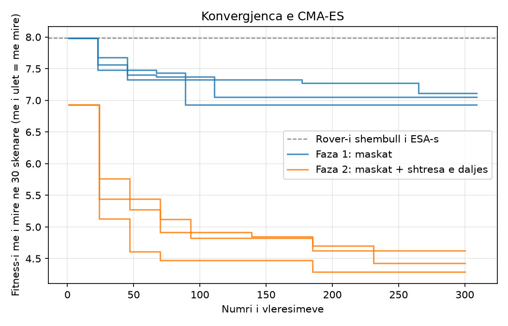
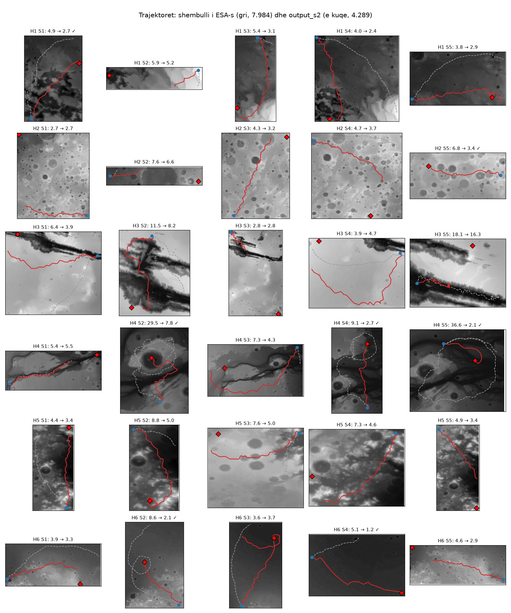

# Morphing Rovers – optimizimi hap pas hapi me CMA-ES

Projekt kursi i bazuar në sfidën **SpOC 2: Morphing Rovers** të ESA-s.

Një rover që ndryshon formën duhet të arrijë mostrën në 30 skenarë në Mars.
Rover-i përshkruhet nga 19 133 numra (4 maska, rrjeti neural, 7 numra të plotë)
dhe optimizohet hap pas hapi me CMA-ES, duke filluar nga rover-i shembull i ESA-s.

## Instalimi
```
py -m pip install -r requirements.txt pytest
py -m pytest -q
```

## Burimet
Simulatori, hartat dhe rover-i shembull janë të ESA Advanced Concepts Team
(https://github.com/esa/SpOC2). Shih `ATTRIBUTION.md`.

## Struktura
```
src/            chromosome.py (ndarja e rover-it), evaluate.py (vlerësimi), parallel.py (paralelizmi)
experiments/    run_masks.py (kërkimi me CMA-ES), validate.py (krahasimi i rover-ave),
                timing.py (kontrolli i skedarëve), baseline.py (analiza e rover-it shembull)
analysis/       plots.py (konvergjenca, maskat), trajectories.py (trajektoret)
tests/          testet, përfshirë krahasimin me kodin e ESA-s
results/        rezultatet e çdo run-i (config.json, log.csv, final.json)
figures/        figurat për raportin
```
## Ekzekutimi
```
py experiments/timing.py         # kontrollon skedarët dhe mat një vlerësim
py experiments/baseline.py       # analiza e rover-it shembull për çdo skenar

# Faza 1: vetëm maskat
py experiments/run_masks.py --scenarios all --seed 1 --workers 5 --out results/masks_all_s1

# Faza 2: maskat + shtresa e daljes, duke filluar nga rover-i më i mirë i fazës 1
py experiments/run_masks.py --free masks+output --start results/masks_all_s2/best_rover.npy --scenarios all --seed 1 --workers 5 --out results/output_s1

# Krahasimi dhe figurat
py experiments/validate.py results/output_s2/best_rover.npy
py analysis/plots.py
py analysis/trajectories.py results/output_s2/best_rover.npy
```
## Rezultatet
Të gjitha të vlerësuara në të njëjtin kompjuter, në 30 skenarë, me 3 seed-e për fazë.

| Rover | Vlera të optimizuara | Fitness | Mostra të arritura | Ndryshimi |
|---|---|---|---|---|
| Rover-i shembull i ESA-s | – | 7.984 | 0/30 | – |
| Faza 1: maskat | 484 | 7.029 ± 0.092 | 1–2 | −12.0% |
| Faza 2: maskat + shtresa e daljes | 566 | **4.446 ± 0.167** | **7–11** | **−44.3%** |
| Faza 3: + shtresa e fshehur | 3 806 | pa përmirësim | – | – |

Rover-i më i mirë: **4.290**, 7/30 mostra (faza 2, seed 2).



## Gjetjet kryesore
- **Kufiri ishte te drejtimi i rover-it, jo te maskat.** Analiza e rover-it shembull tregoi që ai lëviz,
  por jo drejt mostrës. Shtresa e daljes (82 numra) dha 37% përmirësim mbi fazën 1.
- **Maskat ndryshuan vetëm 3–5%** ndaj shembullit, kështu që struktura e tyre vjen nga ESA.
  Megjithatë, kjo mjaftoi për 12% përmirësim, sepse fitness-i është shumë i ndjeshëm ndaj maskave.
- **Fitimet më të mëdha erdhën nga skenarët e shkurtër.** P.sh. Harta 4, Skenari 5: 36.6 → 2.1.
- **Kërkimi në 6 skenarë çon në overfitting:** rezultat më i mirë në 6 dhe më i keq në 30.
  Prandaj çdo rover vlerësohet në të 30 skenarët.
- **Faza 3 nuk ndihmoi** (σ = 1.0 dhe 0.2). Edhe ndryshimet e vogla të rrjetit japin rreth 4.55
  kundrejt 4.29, gjë që tregon një peizazh shumë të ashpër të fitness-it.
- **Platforma ka rëndësi:** i njëjti rover jep 7.979 në Colab dhe 7.984 në Windows,
  prandaj të gjitha krahasimet bëhen në të njëjtin kompjuter.



## Autorja
Florentina Dervishaj
